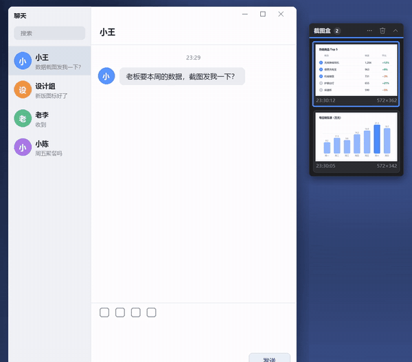

# 截图盒 ClipShelf

截图自动收进屏幕边上的小盒子，要发的时候拖出去就行。

Windows 小工具，单个 exe，不用安装，不联网。

## 解决什么问题

连着截两张图想一起发，剪贴板只记得最后一张，前一张还得回文件夹里翻。截图盒把每一次截图都留在手边，要用哪张拖哪张。

## 功能

- **什么截图工具都行**：Win+Shift+S、PrintScreen、微信 / QQ 截图、Snipaste……截完图进了剪贴板，就会自动收进盒子。
- **复制的图片也收**：在聊天软件、网页里复制的图片，或者在文件夹里选中照片按 Ctrl+C（一次最多 9 张，超过就当作在搬文件，不收），都和截图一样收进来。
- **平时只占一个小方块**：角落里一个图标加张数，点一下展开列表。菜单里也可以改成"鼠标划过就展开"。
- **连收两张才自动展开**：只截一张时不打扰你，小块闪一下、数字加 1，直接 Ctrl+V 就行；2 分钟内收到第二张，才自动展开并保持 1 分钟（每来一张重新计时），标题栏下面那条蓝线就是剩下的时间。时间到了、鼠标也不在上面，就自己收起来。
- **一次拖好几张**：点选几张（左上角会标出 1、2、3 的顺序），拖其中任意一张，选中的会一起拖出去。拖出去的是图片文件，和从资源管理器里拖文件一样，聊天软件、网页上传框、文件夹都能接。
- **双击放大、认出图里的字**：双击一张图，打开一个大窗口看（滚轮缩放、拖动平移），右边自动列出图里的文字，可以直接改、选中复制，或者一键复制全部；点图上的蓝框，复制那一行。表格按行读，两栏的文章按栏读。用的是 Windows 自带的文字识别，全在本机完成，不联网。
- **也能复制粘贴**：右键一张选"复制"，之后按 Ctrl+V；选了几张时，右键可以一起复制。
- **截图时拍不到它**：盒子挡在要截的内容上面也没关系，截出来的图里没有它。
- **全屏时自动隐藏**：全屏游戏、全屏视频、幻灯片放映时，它自动藏起来。还可以指定某个程序在前台时隐藏，默认已经包含雷电、MuMu 模拟器。
- **不抢焦点**：点它的时候，聊天窗口的输入焦点还在，拖进去以后直接回车就能发。
- **不重复、不乱收**：同一张图不会收两次；从 Word / Excel 复制文字和表格时顺带的图片不收。
- **最多留 40 张**：数量可以改，更早的自动删除。

## 下载和使用

**安装版（推荐）**：到 [Releases](../../releases) 下载 `ClipShelf-Setup-1.3.0.exe`，双击按提示安装。

- 装在当前用户的 `%LOCALAPPDATA%\Programs\ClipShelf`，不需要管理员权限。
- 安装时可以选择创建桌面快捷方式、开机自动启动，默认都勾上。
- 卸载：在"设置 → 应用"里找"截图盒 ClipShelf"。卸载会先关掉正在运行的截图盒，再删掉它保存的截图、设置和开机启动项。

**免安装版**：下载 `ClipShelf-1.3.0-portable.zip`，解压到一个普通文件夹（比如 `D:\Tools\ClipShelf`），双击 `ClipShelf.exe`。不要放在 `C:\Program Files` 这类需要管理员权限的地方，因为截图和设置就存在 exe 旁边。想要桌面图标并开机自启，在这个文件夹里运行一次 `ClipShelf.exe --install`。

运行后屏幕右上角会出现一个小方块，之后截的图都会收进去。右键小方块是菜单，可以设置展开方式、开机自动启动、暂停收集、打开截图文件夹等。

第一次运行安装包或 exe 时，Windows 可能会提示"Windows 已保护你的电脑"，这是因为没有数字签名。点"更多信息"→"仍要运行"即可；不放心的话，可以按下面的方法用源码自己编译。

需要 .NET Framework 4.x，Windows 10 和 11 都自带。

## 设置文件

`settings.ini` 在 exe 旁边，改完后先从菜单"退出截图盒"，再重新打开。

| 项 | 默认 | 说明 |
|---|---|---|
| `OpenMode` | `click` | `click` = 点一下展开；`hover` = 鼠标划过就展开 |
| `StayOpenAfterShot` | `1` | 截完图自动展开 |
| `StayOpenSeconds` | `60` | 自动展开后保持的秒数 |
| `StayOpenMinShots` | `2` | 一段时间内收到几张才自动展开（改成 1 就是每截一张都展开） |
| `MultiShotWindowSeconds` | `120` | 上面这"一段时间"有多长（秒） |
| `AutoCollapse` | `1` | 鼠标移开后自动收起 |
| `MaxItems` | `40` | 最多保留几张 |
| `GameProcs` | `dnplayer.exe,MuMuPlayer.exe,MuMuNxDevice.exe` | 这些程序在前台时隐藏 |
| `HideFromScreenshots` | `1` | 截图时不把盒子拍进去 |

## 截图存在哪

exe 所在文件夹下的 `shots\`，文件名是 `shot_日期_时间_编号.png`。所有东西都只存在本机。

## 自己编译

双击 `build.cmd`。它用的是 Windows 自带的 C# 编译器（`C:\Windows\Microsoft.NET\Framework64\v4.0.30319\csc.exe`），不用装 Visual Studio。全部代码都在 `src\ClipShelf.cs` 这一个文件里。文字识别调用的是 Windows 自带的 `Windows.Media.Ocr`，编译时引用的是系统里现成的 `C:\Windows\System32\WinMetadata\*.winmd`，也不用另装 SDK。

做安装包：先装 [Inno Setup 6](https://jrsoftware.org/isdl.php)，再运行 `build-installer.cmd`，安装包输出到 `dist\`。安装脚本是 `installer\ClipShelf.iss`，中文界面用的是 Inno Setup 官方仓库里的 `ChineseSimplified.isl`。

## 已知情况

- 开发和测试都在 Windows 11 上完成。Windows 10（2004 及以后）理论上可以用，但还没实际测过。
- 多显示器且缩放比例不同时，盒子按主屏的缩放显示。
- 文字识别用的是系统里装好的识别语言：中文版 Windows 自带中文识别；如果提示"没装中文文字识别"，到"设置 → 时间和语言 → 语言和区域 → 中文（简体）→ 语言选项"里装上"光学字符识别"。
- 识别准确度：中文正文基本不错；小字号的英文和代码会有错，常见的是 i / l / 1、0 / O 分不清。截图盒会按上下文改掉一部分（比如版本号、文件名、日期），认完的文字在右边可以直接改。

## English

ClipShelf keeps every screenshot you take (any tool: Win+Shift+S, PrintScreen, chat apps, Snipaste…) in a small always-on-top shelf at the edge of the screen. Click it to open, select a few shots, and drag them into a chat window, an upload box or a folder. It opens for a minute when a second screenshot arrives within two minutes, also collects images you copy, and a double-click opens a shot large with built-in text recognition (Windows OCR, fully offline). It stays out of your screenshots, hides while a full-screen app or game is in front, and never steals focus. Single ~150 KB exe (installer or portable zip), no network. MIT licensed.

## 许可

[MIT](LICENSE)
